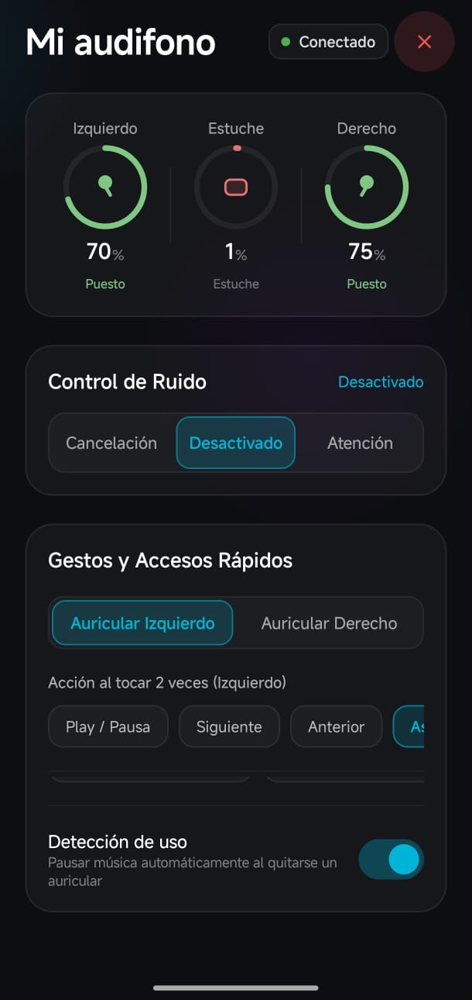

# Freebuds4i_controler

Aplicación moderna para Android diseñada específicamente para gestionar y controlar los auriculares **FreeBuds 4i** 

<p align="center">
  
</p>

## Características

- **Monitoreo de Batería**: Nivel de carga en tiempo real para el auricular izquierdo, auricular derecho y el estuche de carga.
- **Control de Ruido**: Alternar entre Cancelación Activa de Ruido, Modo Desactivado y Modo Atención.
- **Configuración de Gestos**: Personalización de acciones de doble toque y toque prolongado independientes para cada auricular.
- **Detección de Uso**: Activación o desactivación de pausa automática al retirar un auricular.

## Requisitos

- Android 8.0 o superior.

## Instalación

Descarga el archivo APK listo para instalar desde la sección de [Releases](https://github.com/Benja45674/Freebuds4i_controler/releases).

## Compilación

Para compilar el proyecto localmente:

```bash
./gradlew assembleRelease
```

El APK generado se encontrará en `app/build/outputs/apk/release/app-release.apk`.
